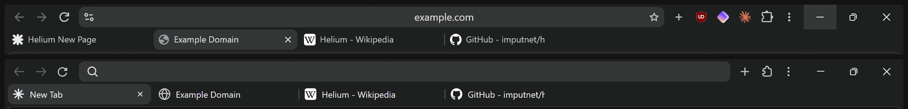

# HeliumFox

[Helium](https://github.com/imputnet/helium)'s look for Firefox, with a few twists from [Latin Accent Plus](https://github.com/rs4t/latin-accent-plus). Just CSS and a settings file: no extensions needed.



*Top: Helium. Bottom: Firefox with HeliumFox.*

Helium is the main inspiration. Its layout, sizes and colors were measured from a running Helium window and checked against Helium's source code, so Firefox lines up with it almost pixel for pixel. HeliumFox is an unofficial fan theme and isn't affiliated with Helium or imput.

## What it copies from Helium

- **Dynamic layout:** one row with back, forward, reload, a wide address bar, `+`, extensions and the menu. Tabs appear in a second row only when 2 or more tabs are open. Helium's Classic, Compact and Vertical layouts are available too (see *Optional: layouts and frameless mode*).
- **Exact sizes:** 28px address bar and buttons, 3px spacing, 197px tabs with 8px corners and thin dividers, and the page inset by 3px with a 1px border and rounded corners.
- **Helium's colors** in dark and light mode. They follow your Windows setting.
- **Address bar:** the URL is centered, there's one "site info" icon on the left and only the star on the right.
- **Loading bar:** a thin line with a soft glow along the bottom of the address bar while a page loads, like Helium's progress bar.
- **Popups:** right-click menus, the menu, downloads, extensions, the site-info panel, permission prompts, the notification bar, the find bar and tooltips all use Helium's style.
- **Small details:** the three-dot menu, a globe icon for sites without one, a star icon on the new tab, and thin overlay scrollbars that only show while scrolling.

## My twists (from Latin Accent Plus)

- **Your Windows accent color**, which can follow your wallpaper, for the focus ring, the loading bar and accent-colored icons and text on hover. Hover backgrounds stay Helium's neutral gray.
- **Bookmarks bar on hover:** with *Only Show on New Tab*, it stays hidden and slides in when you hover the toolbar.
- **Fullscreen warning** as a small pill instead of Firefox's big banner.
- **Calm animations:** the page eases in when you switch tabs, the address-bar results fade in, and the tab ✕ fades in on hover. They're short with no bounce, and turn off when Windows' *Animation effects* is off.
- **No leftover purple:** Firefox 159's built-in violet accent ("Nova") is replaced with your accent color.

---

## Installation

### Quick way (Windows)

Paste one of these into PowerShell and press Enter.

**Theme only:**

```powershell
irm https://raw.githubusercontent.com/rs4t/heliumfox/main/install.ps1 | iex
```

**Theme + Helium's start page** ([Simple-start](https://github.com/SpringDallies/Simple-start) for new tabs and as your homepage):

```powershell
irm https://raw.githubusercontent.com/rs4t/heliumfox/main/install-with-startpage.ps1 | iex
```

The theme installer:
- **Finds your profile:** it finds your Firefox profile and saves the theme as `heliumfox.css` and `heliumfox-content.css`.
- **Imports the theme:** it imports them from `userChrome.css` and `userContent.css`. Other `@import` lines (like [Firefox Compact](https://github.com/rs4t/firefox-compact)) are kept.
- **Replaces Latin Accent Plus:** it switches off Latin Accent Plus and its see-through settings if you had it, and backs up any older theme.
- **Turns on settings:** it enables the settings HeliumFox needs.
- **Arranges the toolbar:** if Firefox is closed, it arranges the toolbar like Helium. Your old settings are saved as `prefs.js.heliumfox-backup`.

The start-page version also downloads Simple-start to `%APPDATA%\Mozilla\Firefox\simple-start`. It adds 2 small config files to the Firefox install folder, so Windows asks for admin rights once. Read what they do in [install.ps1](install.ps1) and [install-with-startpage.ps1](install-with-startpage.ps1).

<details>
<summary><b>Manual install</b> (or Mac/Linux)</summary>

**1. Copy the files.** Open `about:profiles`, find the **Root Directory** of your active profile and open it.
- Copy everything from [`chrome/`](chrome) into a `chrome` folder there. Create the folder if it doesn't exist.
- Copy [`user.js`](user.js) next to it, directly in the profile folder.

If you already have a `userChrome.css` or `userContent.css`, add `@import "heliumfox.css";` or `@import "heliumfox-content.css";` to it instead of replacing it.

**2. Restart Firefox** completely (close it, then reopen it).

**3. Arrange the toolbar like Helium.** Right-click the toolbar and choose **Customize Toolbar…**:
- Drag the **New Tab** (`+`) button from the tab row to just after the address bar.
- Remove the flexible spaces and the sidebar button.
- Pinned extensions go after the `+`.

</details>

**Optional: bookmarks bar.** Right-click the toolbar, then **Bookmarks Toolbar**, then **Only Show on New Tab** to get the hover reveal.

### Optional: Helium's start page

HeliumFox comes with a simple Helium-style new tab page (a gradient with a star). To use the same start page as Helium, use [**Simple-start**](https://github.com/SpringDallies/Simple-start) by SpringDallies. The second install command above sets it up for you. To do it by hand:

1. Download Simple-start and extract it somewhere permanent.
2. In [`newtab/mozilla.cfg`](newtab/mozilla.cfg), replace the example path with the path to its `index.html`.
3. Copy `mozilla.cfg` into your Firefox install folder (e.g. `C:\Program Files\Mozilla Firefox\`), and `autoconfig.js` into its `defaults\pref\` folder. This needs admin rights.
4. Turn off any new-tab extension (like Bonjourr), because those take priority. Then restart Firefox.

To also open it when Firefox starts, go to `about:preferences#home`, open **Homepage and new windows**, choose **Custom URLs…** and paste the same `file:///…/index.html` path.

### Optional: layouts and frameless mode

Install [**Firefox Compact**](https://github.com/rs4t/firefox-compact) to get Helium's layout settings in a popup:

| Layout | What it does |
| --- | --- |
| **Dynamic** (default) | Toolbar on top. The tab row only appears with 2 or more tabs |
| **Classic** | Tab row on top, toolbar below |
| **Compact** | Everything in one row: address bar, tabs, `+`, extensions, menu |
| **Vertical** | Firefox's own vertical tabs (Settings → General → Browser layout), styled like Helium |

It also adds Helium's **Frameless mode**, which hides the toolbars until you hover the top of the window and makes the page go edge to edge. Its **Always show the top bar** option hides only the tabs. The installer keeps Firefox Compact's `@import "compact.css";` line first in `userChrome.css`.

---

## Customize

At the top of `heliumfox.css`:

| Variable | What it does |
| --- | --- |
| `--h-pad` | Spacing around the toolbar and page (Helium: `3px`) |
| `--h-bar` | Height of the address bar, buttons and tabs (Helium: `28px`) |
| `--h-radius` | Corner roundness (Helium: `8px`) |
| `--h-tab-slot` | Tab width (Helium: `201px`) |
| `--h-url-font` / `--h-tab-font` | Text size in the address bar and on tabs |

For a fixed accent color instead of your Windows one, search for `--h-accent: AccentColor;` and replace `AccentColor` with a color like `#7296ff`.

Every section is labeled, so you can delete any feature you don't want. The animations are in their own block near the end of the file.

## Notes

- Dark mode is measured from Helium pixel by pixel. Light mode uses Helium's light colors from its source, but has been tested less.
- Made for **Firefox 159** on **Windows 11**. Firefox updates sometimes rename things. If something breaks, please [open an issue](../../issues).
- The window-button spacing assumes Windows. On Mac or Linux, adjust `--h-caption-width`.

## Credits

- [**Helium**](https://github.com/imputnet/helium) by imput: the browser this theme copies. Its layout, sizes, colors, progress bar, info bar and find bar values come from its source.
- [**Latin Accent Plus**](https://github.com/rs4t/latin-accent-plus) (my other theme), the source of the accent color, bookmarks reveal, fullscreen pill and animations. It's based on [**Latin Accent**](https://github.com/Acercandr0/Latin-Accent) by Acercandr0.
- [**Zen-Nebula**](https://github.com/JustAdumbPrsn/Zen-Nebula) by JustADumbPrsn: the original tab-switch animation (toned down here).
- [**Simple-start**](https://github.com/SpringDallies/Simple-start) by SpringDallies: the optional start page.

## License

[GPL-3.0](LICENSE), the same license as Helium.
